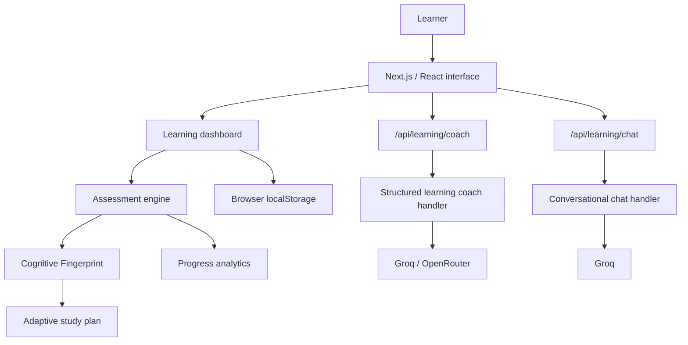

# AdaptIQ

**Learning that adapts to you.**

AdaptIQ is an adaptive learning web application that helps learners identify topic-level knowledge gaps, understand their learning progress, and receive a study plan based on evidence from diagnostic assessments. It also includes an AI Learning Coach for academic explanations and conversational study support.

> **Project status:** The current application includes the landing page, learning dashboard, deterministic assessment and learning-analysis logic, browser-based persistence, and Groq-powered AI endpoints. User authentication, cloud-synchronised learner accounts, and document upload/analysis are future improvements and are not included in the current implementation.

## Table of contents

- [Overview](#overview)
- [Core features](#core-features)
- [How AdaptIQ works](#how-adaptiq-works)
- [Technology stack](#technology-stack)
- [System architecture](#system-architecture)
- [Project structure](#project-structure)
- [Getting started](#getting-started)
- [Environment variables](#environment-variables)
- [Available scripts](#available-scripts)
- [Testing](#testing)
- [Data and privacy notes](#data-and-privacy-notes)
- [Deployment](#deployment)
- [Roadmap](#roadmap)

## Overview

Many learning platforms provide the same material to every learner, even when learners have different levels of understanding. AdaptIQ takes a more responsive approach: it uses a learner's answers to diagnostic questions as evidence for identifying topics that may need attention and for organising suggested study activities.

The application combines a deterministic learning engine with AI-powered tutoring. The learning engine is responsible for assessment evaluation, provisional mastery estimates, progress analytics, and study-plan recommendations. The AI Learning Coach provides explanations and conversational assistance; it does not calculate or modify learner mastery scores or learning records.

## Core features

### Diagnostic assessments

- Provides assessments across Mathematics, Geometry, and Statistics topics.
- Questions are tagged by topic and difficulty: foundational, core, and advanced.
- Evaluates submitted answers using weighted scoring.
- Records question-level responses, assessment results, and topic breakdowns.

### Cognitive Fingerprint

- Aggregates answered-question evidence across assessment attempts.
- Summarises topic-level accuracy and provisional mastery estimates.
- Identifies topics with assessment evidence and topics that still need a diagnostic.
- Retains the latest answered response for each unique question when aggregating retakes.

**Important:** Cognitive Fingerprint values are provisional estimates based on the application's available diagnostic questions. They are not scientifically validated measurements of intelligence or overall ability.

### Adaptive Study Plan

- Generates recommendations from the Cognitive Fingerprint.
- Prioritises topics with lower evidenced mastery estimates.
- Separates focus, development, reinforcement, and diagnostic activities.
- Uses the learner's daily study goal when allocating suggested study time.
- Produces deterministic recommendations: the same input evidence and settings produce the same plan.

### Progress analytics

- Maintains a history of completed assessment attempts.
- Summarises scores, accuracy, time spent, and topic-level progress.
- Compares repeated attempts and reports improvements only where evidence is comparable.
- Avoids presenting unsupported trends when there is insufficient assessment evidence.

### AI Learning Coach

AdaptIQ includes two AI experiences:

1. **Structured learning assistance** through `/api/learning/coach`, supporting mistake explanations, study-plan recommendation explanations, and targeted formative practice. The endpoint validates structured requests and responses.
2. **Conversational AI chat** through `/api/learning/chat`, allowing learners to ask academic questions, request explanations, and work through problems in a conversational format.

The general chat supports recent conversation history, response regeneration, copying responses, request cancellation, input validation, and rate limiting.

The AI is designed as a tutor. It does not update assessment results, Cognitive Fingerprints, progress records, or study plans.

### Learner preferences

- Supports a display name.
- Supports daily study goals of 15, 30, 45, or 60 minutes.
- Includes study-reminder and progress-notification preferences.

## How AdaptIQ works

1. A learner completes a diagnostic assessment.
2. The assessment engine validates the answers and calculates weighted results.
3. The Cognitive Fingerprint aggregates the available answered-question evidence by topic.
4. The adaptive study-plan engine uses that fingerprint and the learner's daily goal to create prioritised recommendations.
5. Progress analytics summarise assessment history and comparable changes over time.
6. The AI Learning Coach provides explanations and practice support without changing the deterministic learning results.

## Technology stack

| Area | Technology |
| --- | --- |
| Framework | Next.js 16 (App Router) |
| UI | React 19 |
| Language | TypeScript |
| Styling | Tailwind CSS 4 and application CSS |
| UI components | shadcn-based components and Base UI |
| Icons | Lucide React |
| Animation | Motion |
| Charts | Recharts |
| Validation | Zod |
| AI provider | Groq |
| Additional structured AI provider | OpenRouter |
| Hosting and analytics | Vercel and Vercel Analytics |
| Package manager | pnpm |

## System architecture

The application uses a Next.js App Router structure. The browser-facing dashboard calls server-side API routes for AI functionality. Assessment evaluation, Cognitive Fingerprint generation, study-plan generation, and progress analytics are implemented as application logic rather than delegated to the AI model.



### AI request flow

- The client sends a request to a Next.js API route.
- The server validates the request and applies request limits.
- The server calls the configured AI provider using server-side credentials.
- The response is validated or safely mapped before it is returned to the client.

API keys must remain on the server and must never be exposed in client-side code or committed to the repository.

## Project structure

The Git repository contains the application in the `project/` directory.

```text
AdaptIQ/
└── project/
    ├── app/
    │   ├── api/
    │   │   └── learning/
    │   │       ├── chat/       # Conversational AI endpoint
    │   │       └── coach/      # Structured AI learning endpoint
    │   ├── dashboard/          # Learning dashboard route
    │   ├── landing/             # Landing page route
    │   ├── globals.css
    │   ├── layout.tsx
    │   └── page.tsx             # Application landing page
    ├── components/
    │   ├── landing/             # Landing page sections
    │   ├── ui/                  # Reusable UI components
    │   ├── adaptiq-dashboard.tsx
    │   └── learning-coach-chat.tsx
    ├── lib/
    │   ├── client/
    │   ├── server/               # AI provider services and request handlers
    │   ├── adaptive-study-plan.ts
    │   ├── assessment-data.ts
    │   ├── assessment-engine.ts
    │   ├── assessment-storage.ts
    │   ├── cognitive-fingerprint.ts
    │   ├── learning-ai-schemas.ts
    │   ├── progress-analytics.ts
    │   ├── user-preferences.ts
    │   └── user-preferences-storage.ts
    ├── public/
    ├── scripts/
    ├── tests/
    ├── package.json
    └── pnpm-lock.yaml
```

## Getting started

### Prerequisites

- Node.js 20.9 or later
- pnpm (the project declares pnpm 12.3.4 as its package manager)
- A Groq API key for the AI features
- An OpenRouter API key if you want to use OpenRouter for the structured learning-coach endpoint

### 1. Clone the repository

```bash
git clone https://github.com/S-Oyeluyi/AdaptIQ.git
cd AdaptIQ/project
```

### 2. Install dependencies

```bash
corepack pnpm install
```

### 3. Configure environment variables

Create a `.env.local` file in the `project/` directory. Add the provider variables required for the AI features you intend to use. See [Environment variables](#environment-variables) below.

### 4. Start the development server

```bash
corepack pnpm dev
```

Open [http://localhost:3000](http://localhost:3000) in your browser.

## Environment variables

The following variables are read by the server-side AI services:

| Variable | Purpose |
| --- | --- |
| `GROQ_API_KEY` | Secret API key used by Groq. Required for conversational AI chat and when Groq is selected for the structured coach. |
| `GROQ_MODEL` | Optional Groq model override. Defaults to `openai/gpt-oss-120b`. |
| `AI_PROVIDER` | Selects the provider for the structured learning-coach endpoint: `groq` or `openrouter`. The code default is `openrouter` when unset. |
| `OPENROUTER_API_KEY` | Secret API key used by OpenRouter when it is selected for the structured coach. |
| `OPENROUTER_MODEL` | Optional OpenRouter model override. Defaults to `openrouter/free`. |

Example local configuration for using Groq for both AI experiences:

```dotenv
AI_PROVIDER=groq
GROQ_API_KEY=your_groq_api_key
GROQ_MODEL=openai/gpt-oss-120b
```

If using OpenRouter for the structured coach, configure `OPENROUTER_API_KEY` and optionally `OPENROUTER_MODEL`, then set `AI_PROVIDER=openrouter`. The general conversational chat endpoint currently calls Groq directly.

**Security:** Do not commit `.env.local`, API keys, or other secrets. Configure production secrets through the hosting provider's environment-variable settings.

## Available scripts

Run these commands from the `project/` directory.

| Command | Description |
| --- | --- |
| `corepack pnpm dev` | Starts the local Next.js development server. |
| `corepack pnpm build` | Creates a production build. |
| `corepack pnpm start` | Starts the production server after building. |
| `corepack pnpm test` | Runs the project's automated test files. |
| `corepack pnpm exec tsc --noEmit` | Runs the TypeScript type check. |

## Testing

The test suite covers the deterministic learning logic, assessment and preference persistence, AI schemas and server handlers, and client-side AI chat integration.

Run the checks from `project/`:

```bash
corepack pnpm exec tsc --noEmit
corepack pnpm test
corepack pnpm build
```

## Data and privacy notes

- Assessment attempts and learner preferences are currently stored in the browser using `localStorage`.
- This means data is associated with the browser in which it was created; the current implementation does not provide authenticated, cloud-synchronised user accounts.
- AI provider keys are accessed by server-side services and should be configured as environment variables.
- The AI chat handler sends the recent conversation history included in the request to Groq to generate a response. Do not enter sensitive personal information into the chat.

## Deployment

The application is deployed on Vercel and uses the Next.js framework.

For this repository, the application root is `project/`. When configuring a Vercel project, set the Root Directory to `project`, configure the required environment variables for the selected AI provider, and deploy the `main` branch.

Live application: [https://adapt-iq-v2-opal.vercel.app](https://adapt-iq-v2-opal.vercel.app)

## Roadmap

The following are potential future improvements and should not be interpreted as features available in the current version:

- User registration, login, and secure authentication.
- Cloud database storage for individual learner profiles and learning records.
- Document upload and analysis to support study assistance grounded in a learner's materials.
- Further improvements to learner-specific personalisation and data management.

---

Developed as an academic software engineering project.
